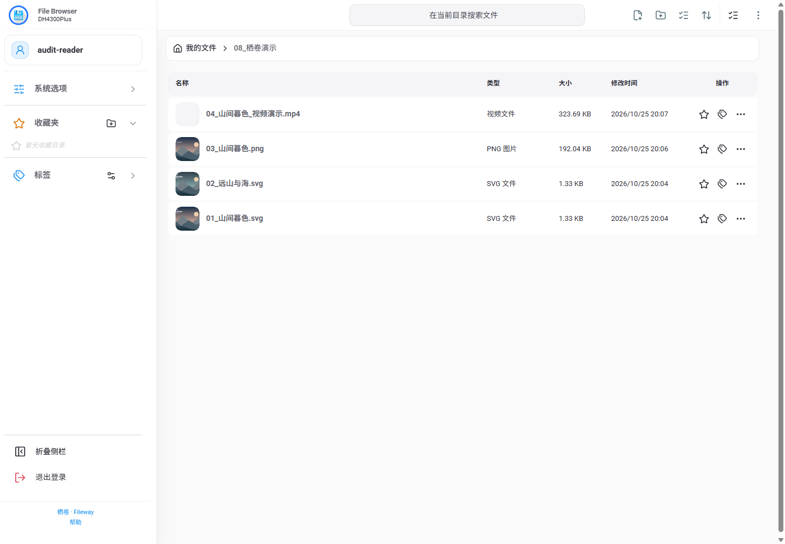
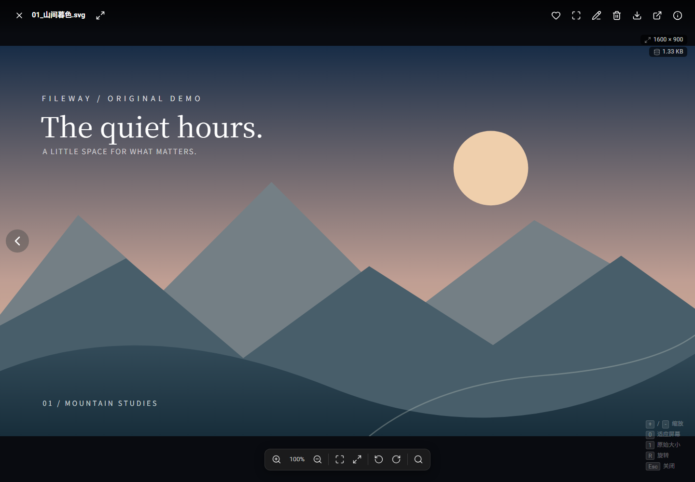
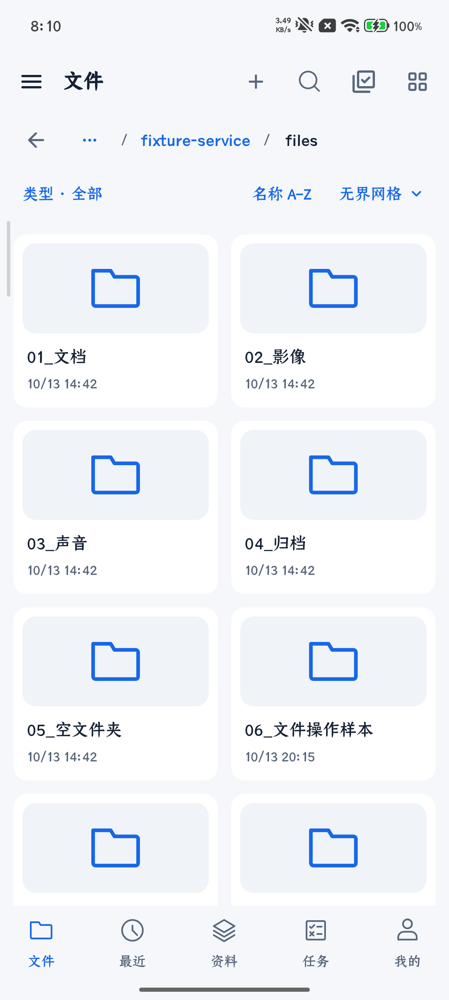
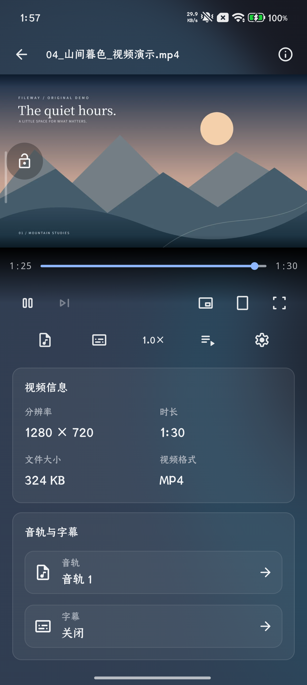

# Fileway · 栖卷

**Your files, photos and media. Your own space, within reach.**

Connect to your server from a browser or an Android phone to manage files, enjoy media and organize your library.

[Android 1.2.2 stable](https://github.com/Kkwans/Fileway/releases/tag/android-1.2.2) · [Download APK](https://github.com/Kkwans/Fileway/releases/download/android-1.2.2/fileway-android-1.2.2.apk) · [Set up a server](#get-started) · [简体中文](README.md)

## A look inside

| Web · File browser | Web · Media preview |
| --- | --- |
|  |  |

| Android · Files | Android · Video |
| --- | --- |
|  |  |

Android screenshots show the **1.1.0 UI**, captured from a candidate with the same interface. All screenshots use demonstration content.

## What you can do

- **Browse and organize:** manage files and folders, search, bookmark, tag and revisit recent items.
- **View and play:** browse images, play audio and video, and preview common document formats.
- **Native Android media:** Media3, FFmpeg audio and libass subtitles, with track selection, playback speeds, resume positions and local caching.
- **Transfers and tasks:** downloads, uploads, server tasks and operation history, with actual progress, timestamps and results.
- **Storage and recovery:** trash, storage analysis and duplicate-file reports for informed cleanup.
- **Your own server:** Linux/NAS and Windows servers share the same Web interface and API, while each instance manages its own accounts and permissions.

Android 1.1 adds system picture-in-picture, flowing artwork ambience, unified player feedback and animated icons, and improves multiselect and storage reports.

## Get started

### 1. Set up your server

Choose a deployment guide and configure file roots, persistent storage and accounts:

- [Linux/NAS containers](deploy/linux/README.md)
- [Windows server](deploy/windows/README.md)

The server includes the Web interface. Open your instance address in a browser once it is running.

### 2. Connect Android

[Download the stable Android APK](https://github.com/Kkwans/Fileway/releases/download/android-1.2.2/fileway-android-1.2.2.apk), install it, enter your own server address and sign in.

- Android **10 or later**, with **arm64-v8a and x86_64** in one APK.
- Install over the existing app to retain accounts, transfer records and settings; the package and signing identity are preserved.
- Connect directly or through the embedded Tailscale connection mode.
- Newer operations depend on server capabilities. Recent-record batch deletion requires server `2026.10.25-v1` or later.

## Documentation and development

| Guide | Contents |
| --- | --- |
| [Android client](clients/android/README_EN.md) | Installation, native media, builds and local state |
| [Server development](server/README.md) | Go backend, Web development and builds |
| [Architecture](docs/server-architecture.md) | Platform boundaries, directories and shared API |
| [Shared client core](clients/shared/core/README.md) | Go networking and transport used by Android |
| [Releases](https://github.com/Kkwans/Fileway/releases) | Published versions, packages and checksums |

When reporting a problem, include the version, platform, reproduction steps and relevant logs. Keep passwords, tokens, account details and private media out of public reports.

## Licenses and credits

Components retain their own licenses: [Apache-2.0 for the server](server/LICENSE) and [GPL-3.0 for Android](clients/android/LICENSE). Third-party licenses and provenance remain with each component; this repository does not relicense them collectively.

Thanks to [File Browser](https://github.com/filebrowser/filebrowser), AndroidX Media3, FFmpeg, libass and the other projects that make Fileway possible.

Animated icons by [Lordicon.com](https://lordicon.com/). Static fallback icons use [Material Symbols](https://github.com/google/material-design-icons).
